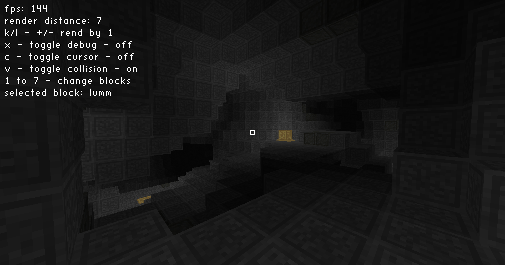
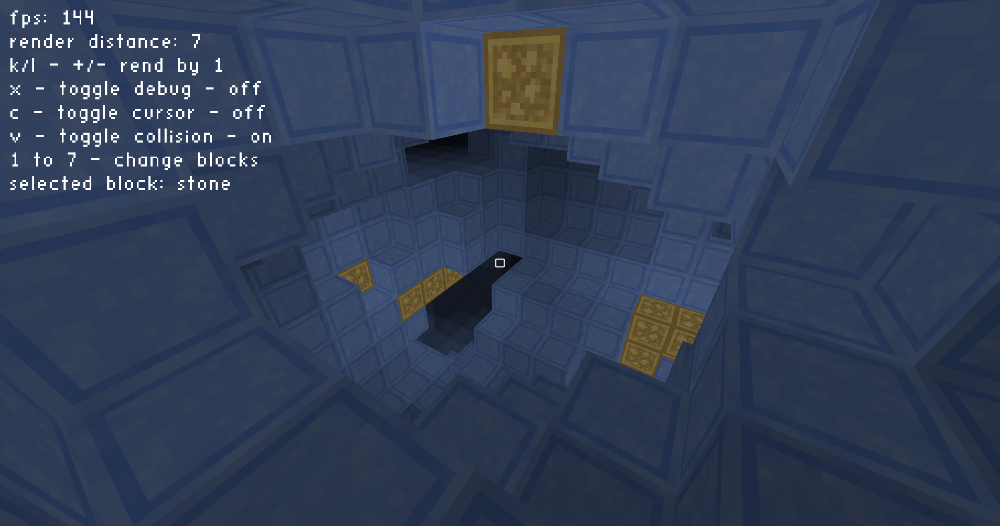
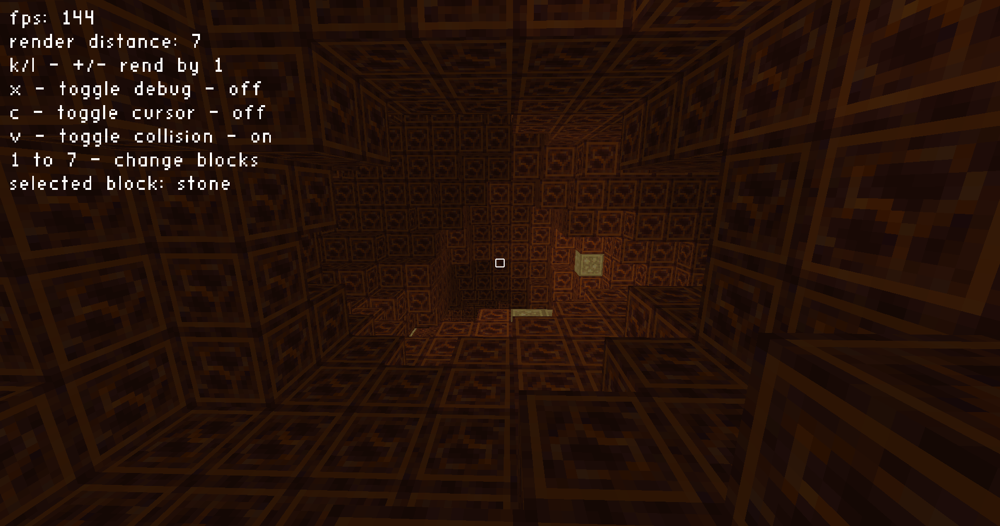
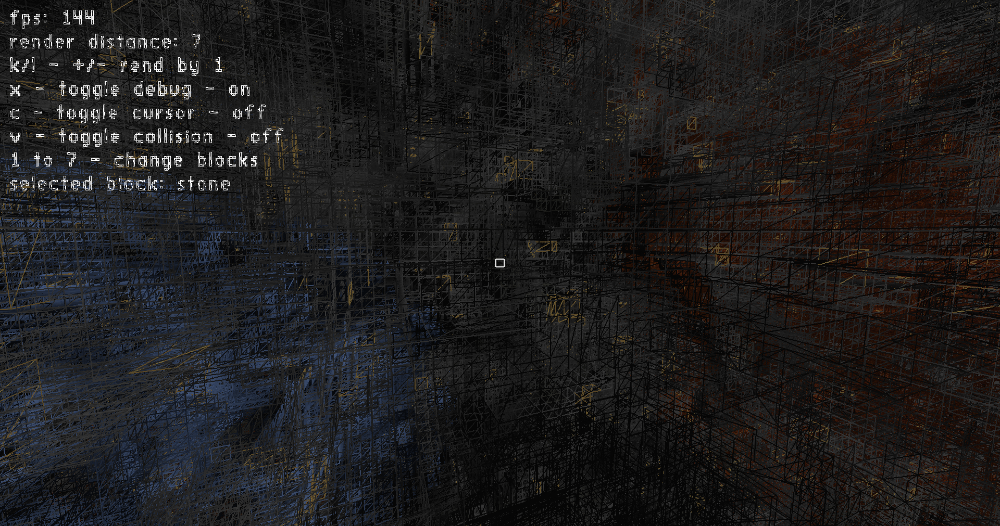

# voidlands

its a work-in-progress voxel game built in c++ and opengl

## screenshots

| | |
|---|---|
|  |  |
|  |  |

## download

download a build from the [releases page](https://github.com/lucynical8/voidlands/releases), extract the archive and run the executable from inside its `build` directory

on linux you may need to make the executable, well, executable first:

```bash
cd build
chmod +x voidlands
./voidlands
```

## building

you need a C++17 compiler, CMake, GLFW, GLM and OpenGL development libraries